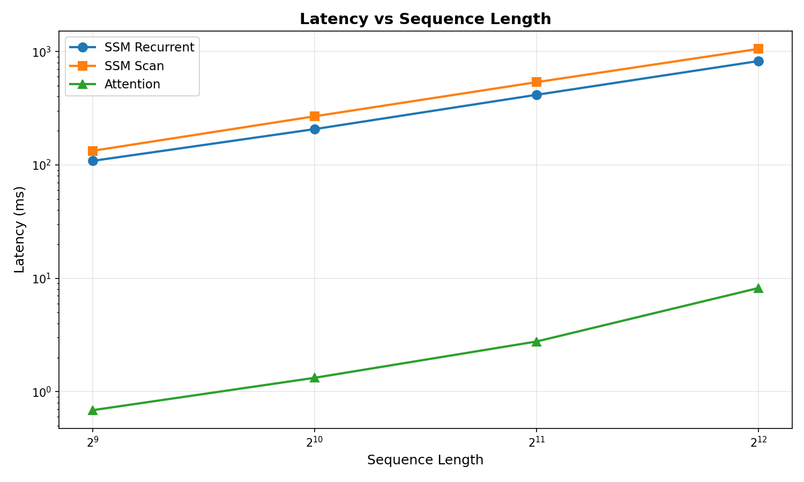
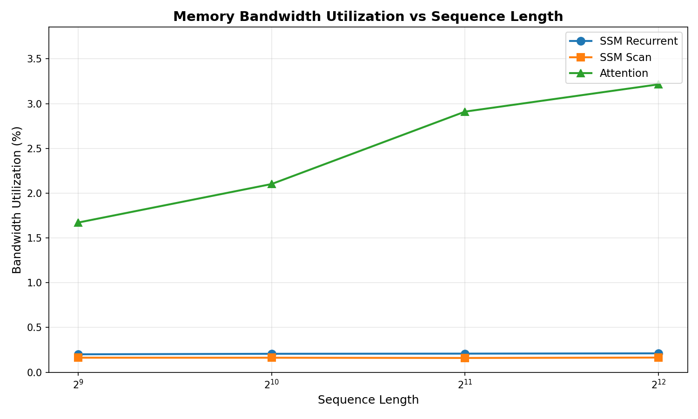
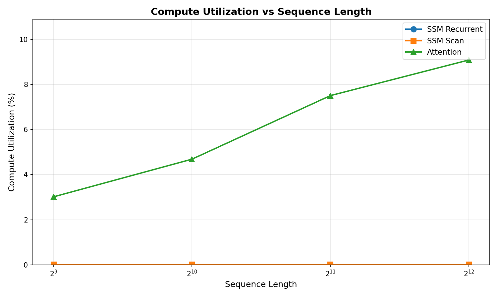
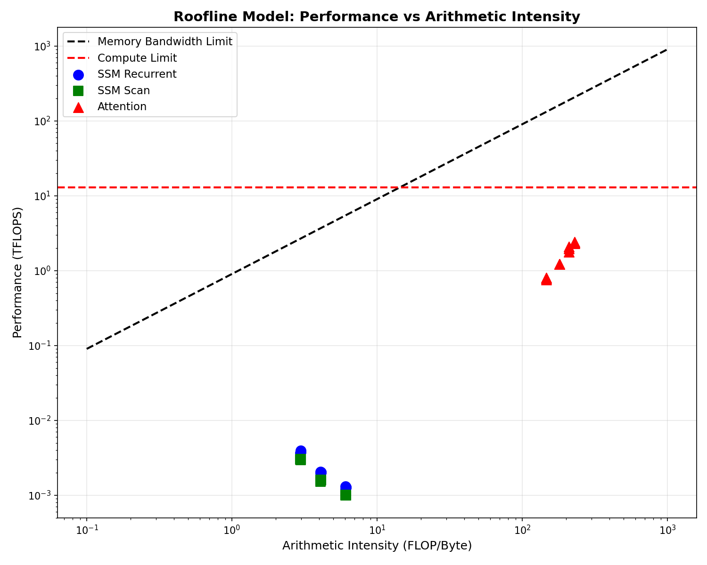

# ssm-bench

Benchmarks for state-space models, attention, and hybrid sequence models on NVIDIA GPUs. Measures latency, memory bandwidth, compute utilization, and energy per token. Everything is reproducible.


[](LICENSE)

📄 [Read the whitepaper](docs/whitepaper.md)

---

## What this does

State-space models (S4, Mamba, Mamba-2, Mamba-3) process sequences in O(N) with a fixed-size recurrent state. Attention is O(N²) and the KV cache grows with context length. On paper, SSMs should be faster and cheaper.

In practice, GPUs are built for dense matrix multiplication. Attention is a bunch of large matmuls. SSMs are a stream of small state updates. The GPU runs both correctly, but it's the wrong shape of hardware for SSMs.

This repo measures exactly how wrong. We benchmark SSM, attention, and hybrid blocks on real GPUs, keep every result reproducible, and publish the raw data.

## Results

We ran benchmarks on two GPUs: Tesla T4 (via Google Colab) and A100-SXM4-40GB (via Modal). 36 configurations per GPU (4 sequence lengths × 3 state dimensions × 3 model types).

Here's what we found:

| | Tesla T4 | A100 |
|---|---|---|
| SSM vs attention latency | 100-200x slower | 1,000-1,500x slower |
| SSM bandwidth utilization | 0.02-0.15% | 0.01-0.08% |
| SSM compute utilization | < 0.2% | 0.006% |
| SSM arithmetic intensity | 3-6 FLOP/byte | 3-6 FLOP/byte |
| Attention arithmetic intensity | 146-229 FLOP/byte | 146-229 FLOP/byte |

The important number is the last row. SSMs are severely memory-bound. Attention is compute-bound. The GPU's compute units barely wake up for SSM workloads.

The other important finding: the gap gets *worse* on better hardware. A100 has 2.3x more bandwidth than T4. Attention takes advantage of it (bandwidth utilization goes from 1.15% to 9.30%). SSM doesn't benefit at all (bandwidth utilization actually drops from 0.15% to 0.08%). SSM latency is identical on both GPUs (319ms average). That tells you the problem isn't the GPU being slow. It's the GPU being the wrong tool.

**Go/no-go decision:** GO. The gap is large enough to justify custom silicon. Proceeding with Continuum SSU-1 (Kalman architecture), a custom processor designed specifically for SSM workloads.

### Raw data

- [Tesla T4 results](profiling/results/t4-colab-2026-10-10/)
- [A100 results](profiling/results/a100-modal-2026-10-10/)
- [T4 vs A100 comparison](profiling/results/analysis/gpu_comparison_t4_vs_a100.md)

### Visualizations

**Latency scaling** - SSM latency vs attention across sequence lengths:



**Bandwidth utilization** - SSM uses almost none of the GPU's memory bandwidth:



**Compute utilization** - The GPU's compute units barely wake up for SSM workloads:



**Roofline analysis** - SSM is severely memory-bound, attention is compute-bound:



## What we measure

| Metric | Unit | Notes |
|---|---|---|
| Latency per token | ms | Median and P95 over 100 runs |
| Prefill latency | ms | For a given prompt length |
| Throughput | tokens/s | Fixed batch size and sequence length |
| Memory bandwidth | GB/s | Achieved vs theoretical peak |
| Compute | TFLOP/s | Achieved vs theoretical peak |
| Arithmetic intensity | FLOP/byte | Tells you if you're memory-bound or compute-bound |
| Peak memory | GB | Weights, activations, state, KV cache |
| Energy per token | J | Via pynvml power telemetry |

## Benchmark matrix

Defined in config files under `configs/`, not hard-coded.

| Axis | Values |
|---|---|
| Model family | Selective-scan SSM (Mamba, Mamba-2, Mamba-3), attention (FlashAttention-2), hybrid (Jamba-style), delta-rule linear attention |
| Phase | Prefill, decode |
| Batch size | 1, scaling up for concurrent users |
| Sequence length | 512-4096 (done), up to 32k (planned) |
| Precision | bf16 (done), fp8 (planned) |

## How we do it

1. **Correctness first.** Every implementation gets checked against a plain NumPy reference before we time anything.
2. **Warm up, then measure.** We throw away warmup iterations. Results are median and P95, never a single lucky run.
3. **Control the machine.** Fixed seeds. GPU clocks locked when possible. Nothing else on the device.
4. **Timing and profiling are separate.** Profilers change performance, so we keep them apart.
5. **Strong baselines.** We compare against the best tuned kernels available:
   - Attention: FlashAttention-2
   - SSM: Official Mamba CUDA kernels
   - Hybrid: optimized kernel per layer type
6. **Roofline analysis.** Every kernel gets placed on a roofline plot so you can see whether it's bandwidth-limited or compute-limited.

## Reproducibility

Every result file ships with a metadata file next to it:

- GPU model, driver version, CUDA version
- PyTorch version, Triton version, everything else
- Random seed
- Git commit hash, clean working tree
- Exact command line and config file
- Timestamp

Results don't get edited by hand. If something's wrong, we fix the script and regenerate. Schema is in [docs/results-schema.md](docs/results-schema.md).

## GPU targets

| Class | Models | Why |
|---|---|---|
| Datacenter | H100, A100 | Current and prior gen datacenter |
| Inference-optimized | L40S | Inference at scale |
| Edge | L4, T4 | Lower power |

Tested so far: T4, A100. More GPUs as we get access.

## Repo layout

```
ssm-bench/
├── model/                  Implementations
│   ├── reference/          NumPy reference
│   ├── pytorch_impl/       PyTorch (GPU-ready)
│   └── tests/              Correctness tests
├── profiling/              Benchmarks
│   ├── results/            Output (JSON, metadata, plots)
│   ├── run_benchmarks.py   Entry point
│   └── visualize.py        Plots and reports
├── configs/                Benchmark matrix
├── docs/                   Whitepaper, methodology, schema
├── Makefile
└── pyproject.toml
```

## Getting started

Linux, Python 3.11+, NVIDIA GPU for benchmarks. CPU-only works for correctness tests.

```bash
git clone https://github.com/Continuum-Computiing/ssm-bench.git
cd ssm-bench
make setup
make test
make lint
```

Run benchmarks:

```bash
# Default sweep
python profiling/run_benchmarks.py

# Custom
python profiling/run_benchmarks.py \
  --seq-lens 512 1024 2048 4096 \
  --state-dims 64 128 256 \
  --dtype bf16 \
  --device 0 \
  --output profiling/results/my_benchmark.json
```

Generate plots:

```bash
python profiling/visualize.py profiling/results/benchmark_results.json
```

## Contributing

Issues and PRs welcome. Corrections to methodology, results on other GPUs, stronger baseline kernels.

Commit messages: `type: summary` (feat, fix, docs, test, chore). No secrets.

## References

- Gu, Goel, Ré. *S4: Efficiently Modeling Long Sequences with Structured State Spaces*, 2021.
- Gu, Dao. *Mamba: Linear-Time Sequence Modeling with Selective State Spaces*, 2023.
- Dao, Gu. *Transformers are SSMs* (Mamba-2), 2024.
- Mamba-3, 2026.
- Dao et al. *FlashAttention*, 2022. FlashAttention-2, 2023.
- Williams, Waterman, Patterson. *Roofline*, 2009.
- Sze, Chen, Yang, Emer. *Efficient Processing of Deep Neural Networks*, 2020.
- AI21 Jamba, 2024.

## Citation

```bibtex
@software{ssm_bench,
  author  = {Lincoln Angufibo},
  title   = {ssm-bench: reproducible benchmarks for state-space, attention and hybrid sequence models},
  year    = {2026},
  url     = {https://github.com/Continuum-Computiing/ssm-bench}
}
```

## License

Apache 2.0. See [LICENSE](LICENSE).

## Continuum SSU-1

This repo measures the GPU gap. The [kalman](https://github.com/Continuum-Computiing/kalman) repo (private) designs the custom processor that closes it. ssm-bench produces the data, kalman consumes it.
